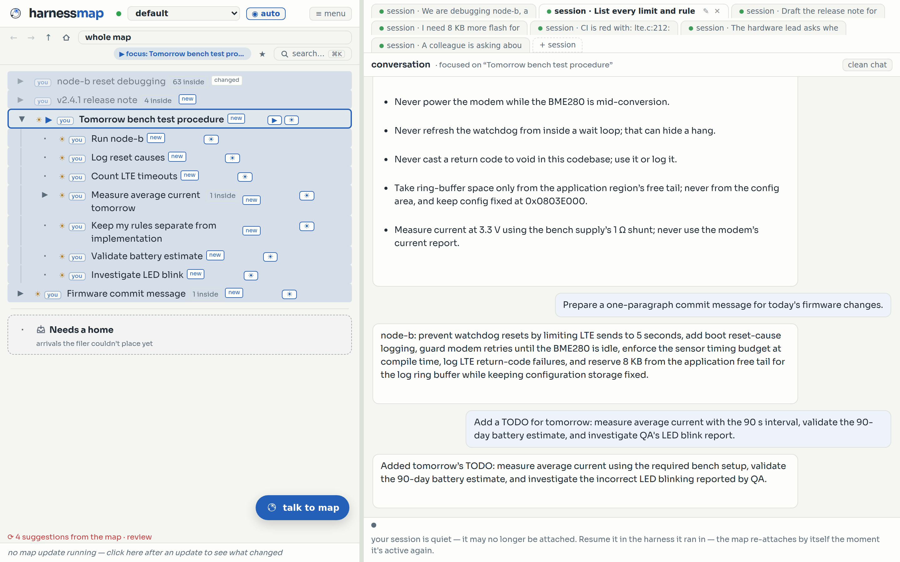

# HarnessMap

**Take control of what your AI keeps in mind.**

HarnessMap is a file manager for your AI's memory. It notes down every decision, limit, idea, and
open question from your chats with your favorite harness, such as Claude Code and Codex, and files
them into a live map. That map is what the agent remembers, and you hold the controls: point the
agent at one topic, dim what it should forget, and see exactly what it knows at any moment. Nothing
gets buried. Everything stays on your machine.

- **Easy to install.** Two commands in Claude Code, one line for Codex.
- **Works with your harness.** Claude Code and OpenAI Codex, CLI or app.
- **Stays on your machine.** No account, no key, no server of ours.
- **You steer the memory.** Point. Dim. See what it knows.



## Why

A chat is a line. Work is a tree. In a line, what you said an hour ago is already under a hundred
messages, and what you said last week is in another chat you would have to find first. The agent
has the same problem: its context fills up, gets compacted, and your "never cast a return code to
void" from Tuesday comes back as a proposal on Thursday.

HarnessMap keeps the tree, and the agent works from it. Three ideas, and everything else follows:

1. **The map** — a tree of your work that files itself as you talk.
2. **Focus ▶** — *talk about this.* The agent's attention goes where you point.
3. **Light ☀ / dim** — *keep this in the background.* Dim a branch and the agent forgets it. You still see everything.

Every cleanup the map proposes waits for your approval. Everything is undoable. Ask the map a
question in plain words ("what limits did I set today?") and it answers from the record.

## Install

You need [bun](https://bun.sh). If it is missing, the Codex installer sets it up, and Claude Code offers to.

### Claude Code (macOS, Linux)

Inside Claude Code, two commands:

```
/plugin marketplace add maincarry/harnessmap
/plugin install map@harnessmap
```

Then start `claude` in any project folder. The map server starts itself, Claude introduces the map
once, and your map is at **http://localhost:8790**. Every project folder gets its own map.

Claude Code on Windows is not tested yet. If you try it, please [tell us](https://github.com/maincarry/harnessmap/issues/new).

### Codex (CLI and app, macOS / Linux / Windows)

One command:

```sh
# macOS / Linux
curl -fsSL https://raw.githubusercontent.com/maincarry/harnessmap/main/install-codex.sh | bash
```

```powershell
# Windows (PowerShell)
irm https://raw.githubusercontent.com/maincarry/harnessmap/main/install-codex.ps1 | iex
```

It installs bun if needed, puts the app in `~/.harnessmap/app`, registers the map's hooks and
skills with Codex, starts the map, and opens it. The Codex app and the Codex CLI share one install.

**One manual step, which Codex requires:** open a terminal in any project, run `codex`, type
`/hooks`, and trust the harnessmap entries. Codex skips untrusted hooks silently and often shows
no prompt. Then start a **new thread** and say *open map*.

Uninstall at any time:

```sh
bash <(curl -fsSL https://raw.githubusercontent.com/maincarry/harnessmap/main/uninstall-codex.sh)          # removes hooks and plugin, stops the server
bash <(curl -fsSL https://raw.githubusercontent.com/maincarry/harnessmap/main/uninstall-codex.sh) --purge  # also deletes the app and every map
```

## Your data stays on your machine

This is the part we want you to be able to trust, so here is exactly what happens.

- **Everything lives in `~/.harnessmap`.** Your maps, chats, and history are one SQLite file,
  `~/.harnessmap/map.sqlite`. Delete the folder and it is gone.
- **We collect nothing.** No analytics, no crash reports, no telemetry, no account, no server of
  ours. There is no endpoint anywhere in this code that your data could be sent to.
- **The map's own thinking runs through the agent you already use.** When the map files a turn or
  answers a question, it calls the model through your own Claude Code login or your own Codex
  login, under the terms you already have with Anthropic or OpenAI. HarnessMap never adds a key, a
  proxy, or a middleman. (You can also point it at your own Anthropic API key. That is opt-in.)
- **The page loads nothing from third parties.** Not even fonts. The map server listens on
  `127.0.0.1` only, and it refuses to listen on any other address unless you set a password.
- **One small network call, which you can turn off.** At most once a day the map asks GitHub for
  the newest version number, so it can tell you when an update exists. The request carries nothing
  about you beyond the build you are running. Set `HARNESSMAP_NO_UPDATE_CHECK=1` to turn it off.
- **One file in your project folders.** The map writes a plain-text copy of your project's map to
  `.harnessmap/MAP.md` inside each project you work in, so the agent can read it. A `.gitignore`
  is written beside it so it never lands in your repository.

The code is open. If you find anything that contradicts this list, it is a bug: [open an issue](https://github.com/maincarry/harnessmap/issues/new).

## Using the map

Open the map page and press **?** for the guided tour. The short version:

| Control | What it does |
|---|---|
| **▶ focus** | the one node the conversation is aimed at; the agent's attention follows it |
| **☀ light / dim** | the agent sees only lit branches; dimmed stays visible to you, invisible to it |
| **talk to map** | ask the map anything about what was said, by whom, when |
| **⟳ to tidy** | the map's own cleanup proposals; nothing applies without you |
| **↩ undo** | every delete, merge, tidy, or move is reversible (Ctrl/Cmd+Z) |
| **+ session** | start a new session aimed at a topic you pick, from an embedded terminal or the built-in chat |
| **🔧 dev mode** | see every call the map makes and every piece of context it hands the agent, verbatim |

Slash commands inside Claude Code:

| Command | Does |
|---|---|
| `/map:status` | server URL, current map, node count, where the data lives |
| `/map:open` | open the map in your browser |
| `/map:stop` | stop the server (all data stays in `~/.harnessmap`) |
| `/map:restart` | restart it (after an update, or if the map looks stuck) |

If you use Claude Code and Codex in the same folder, they share one map.

## Updates

The map tells you in one line when a newer version exists, and updates itself from the ⬆ menu.
In Claude Code you can also run `/plugin update map@harnessmap` and restart Claude Code. For
Codex, rerun the one-line installer.

## Desktop companion (in development)

A small always-on-top window that shows the focused node, pulses when the map is filing, and
opens the map or a question box in one tap. It will support macOS and Windows. It is not released
yet. Details and the current state are in [companion/README.md](companion/README.md).

## Troubleshooting

- **Codex: the map does not appear after a new thread.** Run `/hooks` in the Codex CLI again and
  trust the entries, then `bun run ~/.harnessmap/app/hooks/enable-codex.ts --force`, quit the app
  fully, and reopen.
- **Claude Code: the map looks stuck or old.** `/map:restart`.
- **Anything else, on a Codex install.** `bun run ~/.harnessmap/app/hooks/doctor.ts` prints what works and what does
  not, with the fix for each.

## Running from source

```sh
git clone https://github.com/maincarry/harnessmap.git && cd harnessmap
bun install
bun run src/server.ts            # → http://localhost:8790
```

No API key is needed: the map uses your Claude Code or Codex login. `.env.example` lists the
optional settings (port, binding with mandatory password, model pins, the update-check switch).

Tests run without any key:

```sh
bun test                              # unit tests
bun run src/eval/repo-hygiene.ts      # nothing tracked may be history, a log, a database, a key, or a third-party asset
bun run src/eval/install-smoke.ts     # fresh-machine install simulation
bun run src/eval/integration.ts       # end-to-end checks against a real server
bun run src/eval/ui-smoke.ts          # boots the real page and clicks through it
```

## Contributing

Conversation history, run artifacts, logs, and databases never go to GitHub. A pre-commit guard
refuses them and key-like strings. Enable it once per clone:

```sh
git config core.hooksPath .githooks
```
